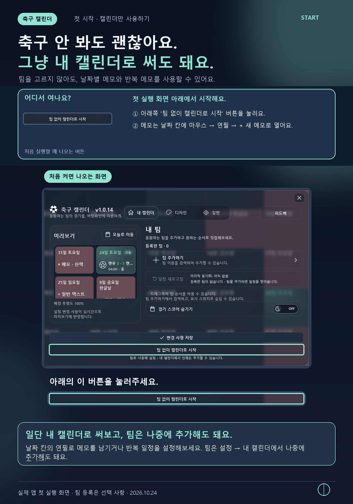
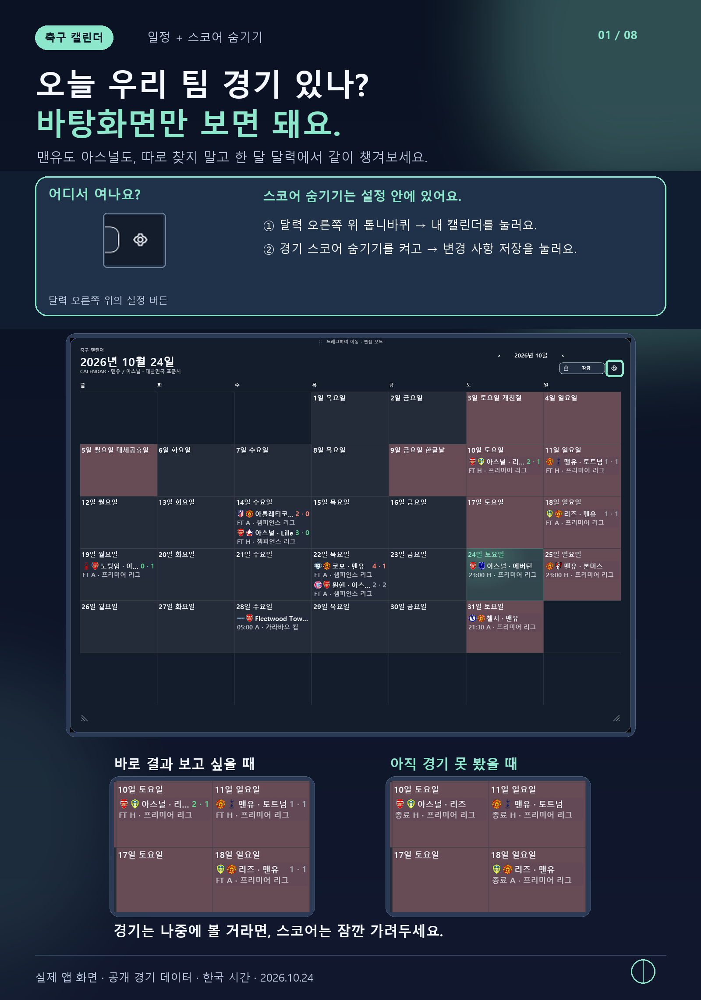
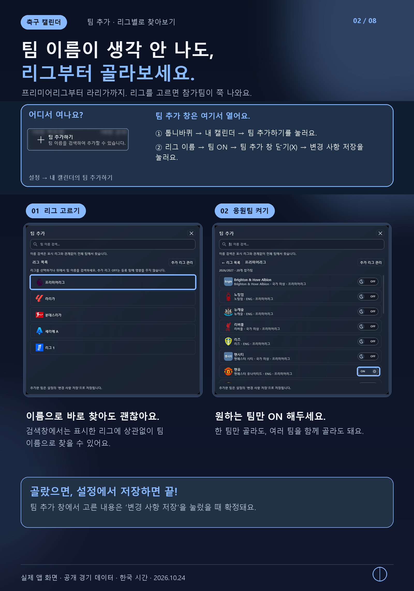
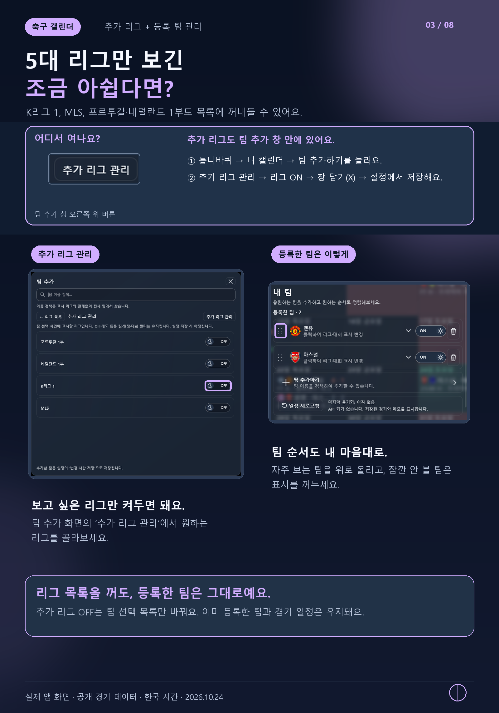
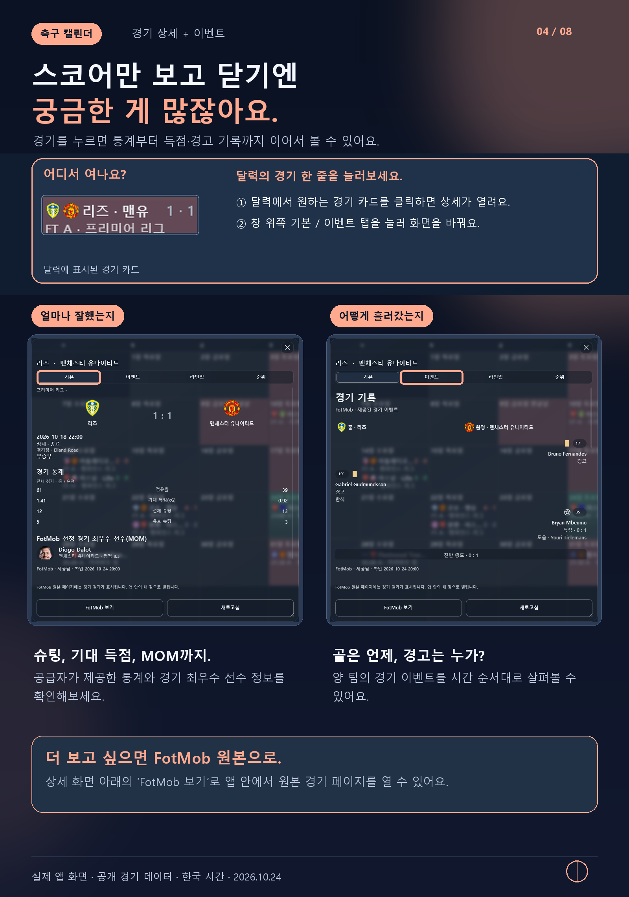
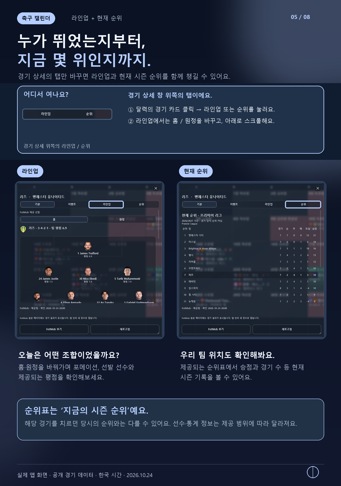
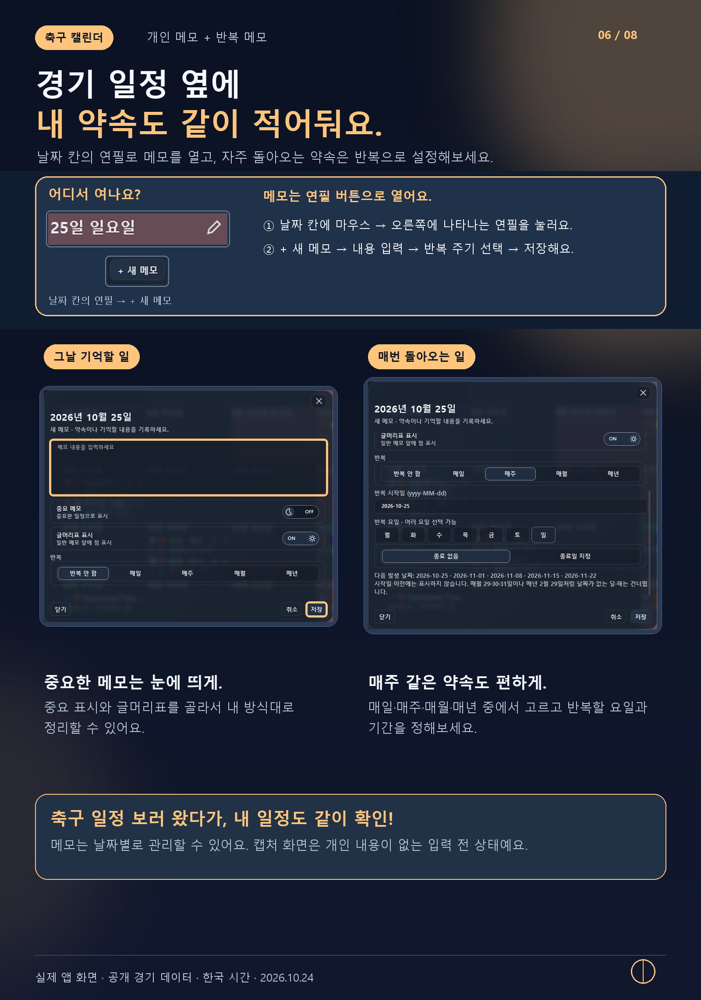
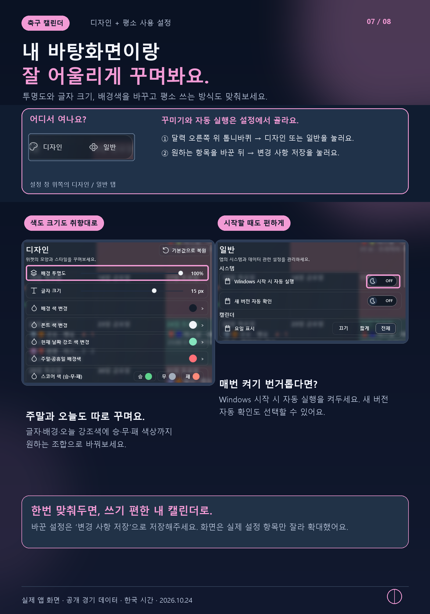
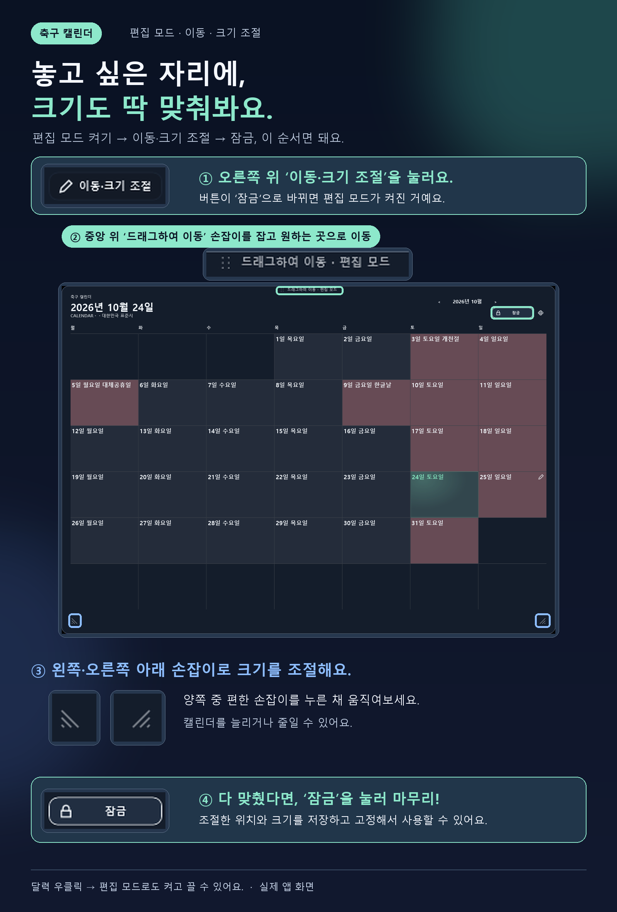
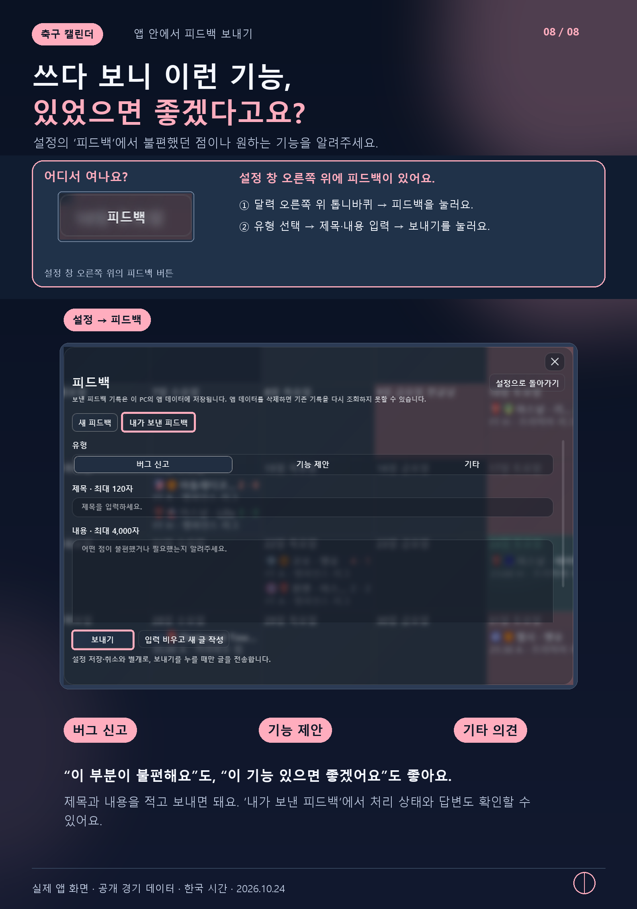

# ⚽ 축구 캘린더

**좋아하는 팀의 경기 일정을 윈도우 바탕화면에서 바로 확인하는 캘린더** 
축구를 보지 않아도 메모·반복 일정용 바탕화면 캘린더로 쓸 수 있어요.

### [⬇️ 최신 버전 다운로드](https://github.com/SAMDO4/FootballCalendar/releases/latest)

> [!CAUTION]
> ## ⚠️ 처음 실행할 때 꼭 보세요
> ### 「Windows의 PC 보호」 파란 창이 떠도 괜찮아요
> 바이러스가 아니라, 개인이 만든 프로그램이라 Windows가 띄우는 안내예요.
> ### 👉 창에서 `추가 정보` → `실행` 을 누르면 정상적으로 실행돼요

---

## 🚀 시작하기

1. 위 **최신 버전 다운로드**에서 버전 번호가 적힌 zip 파일을 받으세요.
   - GitHub가 자동으로 붙이는 **Source code** 압축 파일은 실행용이 아니에요.
2. 압축을 푼 뒤 `축구 캘린더.exe`를 실행하세요.
3. 파란 보호 창이 뜨면 위 안내대로 `추가 정보` → `실행`을 누르세요.
4. 처음 실행하면 응원팀을 고르거나, <b>「팀 없이 캘린더로 시작」</b>을 누르면 끝!

## 🔄 업데이트

새 버전이 나오면 프로그램 오른쪽 아래에 알림이 표시돼요. **업데이트 확인**에서 바로 업데이트할 수 있고, 
등록한 팀·메모·반복 일정·디자인 설정은 그대로 유지돼요.

---

## ✨ 이렇게 써요

### 📅 축구 안 봐도 괜찮아요

팀을 고르지 않아도 메모·반복 일정용 바탕화면 캘린더로 바로 쓸 수 있어요.

### 👀 바탕화면에서 바로 확인

오늘 우리 팀 경기가 있는지 바탕화면만 보면 끝. 결과가 궁금하지 않을 땐 스코어를 숨길 수 있어요.

### 🔍 리그에서 응원팀 찾기

팀 이름이 생각나지 않아도 리그를 눌러 참가팀 목록에서 골라 ON 하면 돼요.

### 🌍 추가 리그와 팀 정리

포르투갈·네덜란드·K리그1·MLS를 켜고, 등록한 팀의 순서도 원하는 대로 정리해요.

### 📊 경기 통계와 이벤트

스코어만 보고 닫기 아쉬울 때, 슈팅·점유율부터 골·카드 기록까지 확인해요.

### 🧾 라인업과 현재 순위

누가 뛰었는지, 지금 리그에서 몇 위인지 한 화면에서 볼 수 있어요.

### 📝 메모와 반복 일정

경기 일정 옆에 내 약속도 함께. 중요 표시와 매주·매달 반복 일정도 돼요.

### 🎨 디자인 꾸미기

색·투명도·글꼴부터 승·무·패 스코어 색까지, 내 바탕화면에 어울리게 꾸며요.

### ↔️ 이동·크기 조절

편집 모드에서 원하는 자리로 옮기고, 오른쪽·왼쪽 아래 모서리로 크기를 맞춰요.

### 💬 피드백 보내기

쓰다가 불편한 점이나 원하는 기능이 생기면 설정에서 바로 의견을 보낼 수 있어요.

---

## 📌 주요 기능

| 구분 | 내용 |
|---|---|
| 📅 캘린더 | 바탕화면 위젯, 공휴일 표시, 날짜별 메모·반복 일정, 팀 없이도 사용 가능 |
| ⚽ 경기 | 응원팀 경기 일정 자동 표시, 종료 경기 스코어, 승·무·패 스코어 색, 스코어 숨기기 |
| 🔍 팀 선택 | 5대 리그 + 포르투갈·네덜란드·K리그1·MLS 참가팀 목록, 이름 검색, 여러 팀 등록 |
| 📊 경기 상세 | 기본 정보·이벤트·라인업·순위 탭, FotMob 원본 보기 |
| 🎨 디자인 | 배경·글자·강조색, 투명도, 글꼴, 주말·공휴일 색, 실시간 미리보기 |
| ⚙️ 편의 | Windows 시작 시 자동 실행, 시간대·시즌 설정, 자동 업데이트, 피드백 |

## 💻 지원 환경

- Windows 10 / 11 (x64), .NET Framework 4.8
- FotMob 원본 보기 창에는 Microsoft Edge WebView2 Runtime이 필요할 수 있어요.

경기 일정·결과·로고는 공개 데이터 기반이며, 각 권리는 해당 권리자에게 있습니다.

